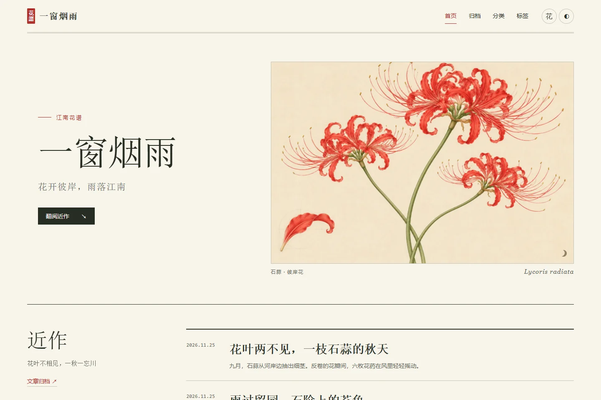

# 一窗烟雨 · 江南花谱

suluo-garden 4.0.0 是一套以江南植物图谱为设计线索的 Halo 2 博客主题。首页以彼岸花工笔图版配题字，近作按日期编排。文章、独立页面、归档、分类、标签和友链共用纸色、墨色和朱红的阅读界面。

[手机首页预览](docs/v4-mobile.webp)

## 安装与升级

下载 [4.0.0 安装包](https://github.com/Lzq2190/suluo-garden/raw/refs/heads/main/dist/suluo-garden-4.0.0.zip)，在 Halo 后台的主题管理中上传。主题要求 Halo 2.20.0 或更高版本。由 3.x 升级时使用同一主题标识，继续读取已有题字、配色和园景设置。

## 外观

- 在「题字」中修改封面标题、副标题、近作栏题签、强调色和页脚文字。
- 在「园景」中选择彩绘或单色图版，设置月牙、页眉双线、图版视差和点击墨圈。关闭图版可使用纯文字封面。
- 在「花事」中修改图版动效及数量。读者可切换明暗和花事，浏览器会记住选择。跟随系统的减少动态效果设置。
- 首页图版、样式和脚本随主题分发。文章与友链图片使用站点内容中的地址。
- 友链入口由 Links 插件提供。评论和页脚注入沿用 Halo 接口。

## 文件

`templates/layout.html` 提供页眉与页脚，`templates/modules/journal.html` 提供文章目录与分页。主题样式与脚本在 `templates/assets/`。主题遵循 [MIT 许可证](LICENSE)。
