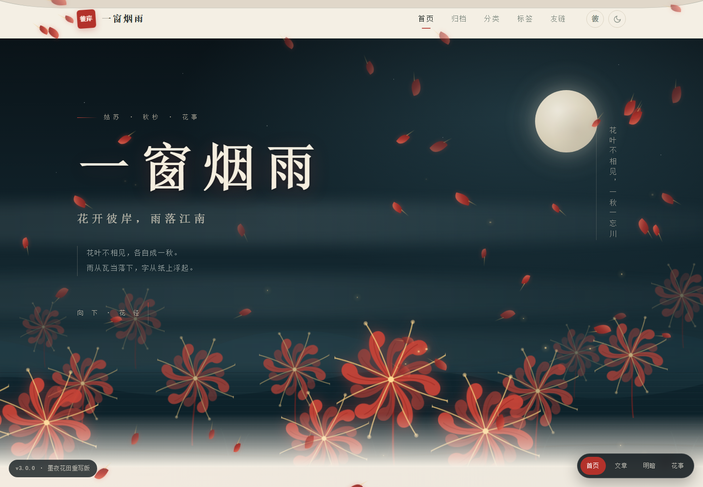
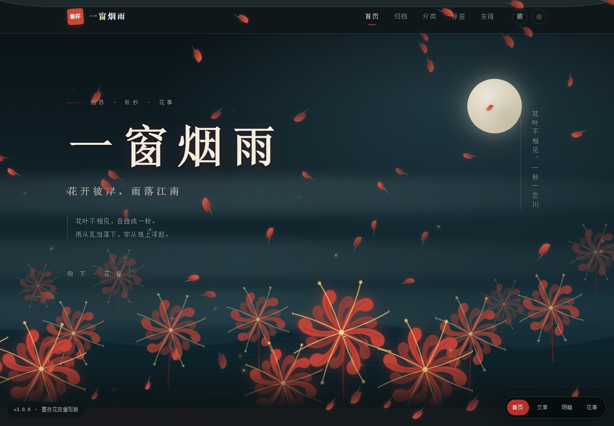
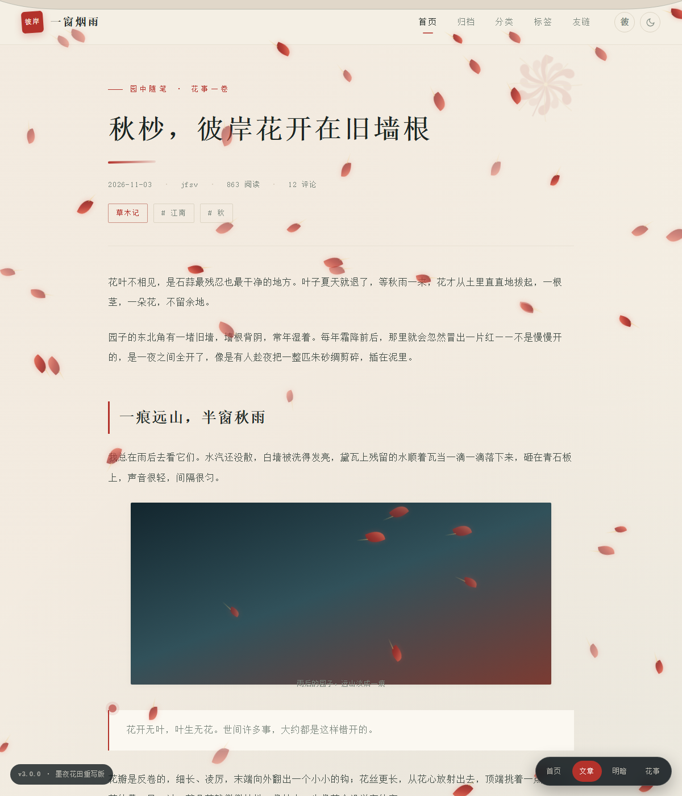

# 彼岸花事 · 一窗烟雨

> 花开彼岸，雨落江南。花叶不相见，各自成一秋。

[源码仓库](https://github.com/Lzq2190/suluo-garden) · [下载 v3.0.0](https://github.com/Lzq2190/suluo-garden/releases/tag/v3.0.0) · [线上效果](https://www.jfsv.cn/)

一套从「苏落江南」（抖音号 `suluoyingxiang`）影像里提炼画面语言、并以**彼岸花为主视觉**重写的 Halo 2 主题。

**v3.0.0 是整版重写，不是补丁**：v2 把彼岸花做成"可切换的小粒子 + 页脚三株小花"，视觉上存在感太弱。v3 把花升为整幅首屏母题——墨夜朱燃的花田、月轮、远山、水光，配合宣纸朱砂的正文；花本身由 SVG 精确画出反卷花瓣、放射花丝与花茎，会随风摆、会呼吸、会落成雨。







---

## 一、v3 到底改了什么

| | v2.1.0 | v3.0.0 |
|---|---|---|
| 彼岸花定位 | 第四种天气粒子 + 页脚 3 株线稿 | **整片首屏花田**，17 株分三层景深，全站复用同一朵 SVG 花 |
| 首屏 | 浅色漏窗小景（八角窗 + 池水） | **恒暗的墨夜花田**：月轮、远山、雾带、水光、朱红花海 |
| 明暗 | 首屏随正文变色 | 首屏恒为墨夜朱燃，正文在宣纸朱砂 / 墨夜之间切换，形成强对比 |
| 花的样子 | 5 条描边线稿 | 12 片反卷填充花瓣 + 8 根花丝（末端光点呼吸）+ 花茎，可作水印、分隔、印章 |
| 动态 | 飘落粒子 | 花田错相位摆动、花朵呼吸、花丝明灭、萤火上升、落花成雨、鼠标视差、朱晕点击 |
| 文章卡片 | 普通卡片 | 朱色侧栏浮现、右下花印随 hover 显现、封面缓慢推近 |
| 内页可读性 | 粒子全屏等强度 | `:has(.hero)` 判定——首页全开，文章/归档等内页自动压到 42% |
| 页脚 | 远山 + 3 株花 | 整排花田剪影 + 文案柔化衬底（备案号不被花盖住） |
| 花朵复用 | 一次性 | `<symbol id="m-plant">` + `<use>`，首屏、卡片、章节、文章、页脚共用一套图形 |

---

## 二、元素来源与转译

抖音站内视频无法直接播放（搜索页动态渲染，公开接口返回 `blocked`），因此元素来自**可查证的公开文字记录**，不是对视频截图的复制：

| 来源 | 画面元素 | 主题里的对应 |
|---|---|---|
| 今日头条 2026-10-04《雨中苏州园林，藏着江南最绝的意境》对「苏洛江南」视频的逐帧转述 | 细雨洗亮园林、白墙黛瓦被雨雾笼住 | 首屏雾带、水光、薄檐、细雨花事 |
| 同上 | 飞檐雕刻、亭台淡成水墨 | 顶部平檐翘角、双层远山淡墨 |
| 同上 | 池中红鲤甩尾溅水、雨丝落池塘 | 点击朱晕涟漪、池面波纹、锦鲤朱（后由彼岸朱接替为主色） |
| 同上 | 国风 BGM「泼墨画山水」、慢节奏 | **不做自动播放音频**；改用墨晕/朱晕入场、花朵缓摆、长周期动画 |
| `cuneme.app` 转载《Autumn Sweet Osmanthus Rain over Classical Chinese Garden Roofs – 苏洛江南》 | 4K 秋日空镜、金桂飘落古建屋檐 | 「桂雨」花事、秋杪题字 |
| 同题材构图资料 | 八角漏窗取景、雨打芭蕉、远山一痕 | 章节花印、页脚远山、宣纸留白 |
| 用户追加要求 | 彼岸花，且要动态 | **v3 主视觉**：花田 / 花丝 / 落花 / 萤火 |

> 若你有具体视频链接或截图，元素表（镜头色调、季节母题）还能再校准一轮。

---

## 三、视觉系统

### 配色

| 角色 | 浅色（宣纸朱砂） | 深色（墨夜朱燃） |
|---|---|---|
| 底色 | `#F4EFE4` | `#0F171A` |
| 卡片 | `#FBF8F1` | `#182328` |
| 标题 / 正文 | `#1B2421` / `#414C46` | `#F0EBDF` / `#BAC4BC` |
| 彼岸朱 | `#B3322B` | `#E44B3D`（自动提亮） |
| 花丝 / 光点 | `#C9973A` / `#F0C46B` | `#EFC170` / `#FFD98E` |
| 首屏 | **恒为** `#0A1318 → #193038` 墨夜，花瓣 `#E8503F` | 同左 |

颜色由 CSS 变量驱动，后台「彼岸朱」改色后，首屏花瓣会用 `color-mix()` 自动提亮，正文花印、印章、按钮同步变化。

### 首屏构成（从后到前）

1. 墨夜渐变 + 星点 + 右上月轮（呼吸光晕）
2. 双层远山剪影、三条缓慢横移的雾带
3. 底部水面波纹与暗色地平线
4. 三层景深的彼岸花田：远景模糊淡化 → 中景半透 → 近景带朱红光晕，每株错相位摆动
5. 左侧大标题 / 副标题 / 题记 / 向下花径；右侧竖排题跋
6. 底部渐隐到正文纸色（`hero-veil`）

### 动效清单

| 动效 | 触发 | 降级 |
|---|---|---|
| 花田摇摆、花朵呼吸、花丝明灭 | 常驻，7s / 6.5s / 3.4s 周期，错相位 | `prefers-reduced-motion` 全停 |
| 落花花瓣（11–21px，带花丝与旋转）、萤火上升 | 「彼岸」花事（默认） | reduced-motion 隐藏 |
| 细雨 / 桂雨 | 花事切换 | 同上 |
| 花田鼠标视差 ±22px | 仅精确指针设备 | 后台可关 |
| 点击朱晕双环 | 点击非交互区 | 后台可关 |
| 卡片墨晕入场、朱色侧栏、花印浮现 | 滚动进入视口 / hover | 无观察器时直接显示 |

---

## 四、安装

1. 从 [GitHub Releases](https://github.com/Lzq2190/suluo-garden/releases/tag/v3.0.0) 下载 `suluo-garden-3.0.0.zip`（根层级 `theme.yaml`，Halo 可直接识别）。
2. Halo 后台 → **外观 → 主题 → 安装主题** → 上传 zip → 启用。
3. 或把 `suluo-garden/` 整个目录放到服务器 `.../data/halo2/themes/`，再在后台启用。
4. 备案号由 `<halo:footer />` 输出，位于页脚文案区内，**不要删**。

### 升级注意

- 改过 CSS / 模板后，必须同时把 `theme.yaml` 的 `version` 往上调并重启 Halo：静态资源是 URL 粒度的长缓存，主题用 `?v=${theme.spec.version}` 破缓存。
- 首页与内页的粒子强度依赖 `body:has(.hero)`；若自定义了首页模板，记得保留 `.hero` 容器。

---

## 五、后台设置

| 分组 | 项 | 默认 | 说明 |
|---|---|---|---|
| 题字 | 首屏大标题 / 副标题 / 题跋 / 页脚诗句 | 一窗烟雨 / 花开彼岸，雨落江南 / … | 大标题留空用站点标题 |
| 题字 | 彼岸朱 | `#B3322B` | 花瓣、印章、强调色，深色自动提亮 |
| 花事 | 默认花事 | 彼岸 | 彼岸（落花+萤火）/ 细雨 / 桂雨 / 静 |
| 花事 | 落花数量 | 72 | 桌面端，移动端自动减半，0 = 关闭 |
| 花事 | 显示花事切换按钮 | 开 | 右上角「彼 / 雨 / 桂 / 静」循环，选择记在 `localStorage` |
| 园景 | 月轮 / 飞檐 / 远山花田 / 鼠标视差 / 点击朱晕 | 全开 | 逐项可关 |

---

## 六、目录结构

```
suluo-garden/
├── theme.yaml              主题元信息（v3.0.0）
├── settings.yaml           后台设置表单
├── README.md / LICENSE
├── docs/                   预览截图（不打进安装包）
└── templates/
    ├── layout.html         全站布局、SVG 花定义、花事脚本、页脚备案
    ├── index.html          墨夜花田首屏 + 文章列表
    ├── post.html           文章页
    ├── page.html           自定义页面
    ├── archives.html       归档
    ├── categories.html / category.html
    ├── tags.html / tag.html
    ├── links.html / error.html
    └── assets/
        ├── css/main.css    整套视觉系统（~650 行）
        └── images/logo.svg
```

### 实现要点

- **一朵花，全站复用**：`<symbol id="m-plant">` 里用 `<use>` 旋转复制花瓣与花丝；CSS 变量写在 `<use>` 上，确保克隆进 SVG shadow tree 后仍能吃到首屏的亮朱配色。
- **Thymeleaf**：官方布局签名 `th:fragment="html(head, content)"`；页面用 `th:replace="~{layout :: html(head = ..., content = ~{::content})}"`；文章正文 `th:utext="${post.content.content}"`。
- **字体**：霞鹜文楷走 `gcore.jsdelivr.net`，`media="print" onload` 非阻塞加载，失败时由系统宋体兜底。
- **插件适配**：summaraidGPT / 洞察图谱用 Shadow DOM，只能通过 `--likcc-summaraid-*` / `--likcc-reading-*` 变量改色，已在两套明暗变量里覆盖。
- **无障碍**：`prefers-reduced-motion` 全量降级；装饰层 `aria-hidden="true"`；导航高亮由 `location.pathname` 判定。

---

## 七、部署状态（2026-11-11 15:20）

- **已上线** `www.jfsv.cn`（Halo 2.26.1）。主题目录 `/www/dk_project/dk_app/halo/halo_iHh6/data/halo2/themes/suluo-garden/`；extensions 登记 `/registry/theme.halo.run/themes/suluo-garden`（`phase: READY`），`data.theme.active = suluo-garden`；重启 `halo_ihh6-halo_iHh6-1` 后生效。Halo 已自动创建 `/registry/settings/suluo-garden-setting` 与 `/registry/configmaps/suluo-garden-configMap`。
- 切换前系统配置快照：`/root/system-configmap-backup-20261111.json`。
- 线上验证：首页 200（`hero-field` / `m-plant` / `main.css?v=3.0.0` / 备案号均在，旧主题引用 0）；`/archives` `/categories` `/tags` `/links` 全 200，不存在的路径正确 404；文章页 200；CSS 与 logo 200；Halo 日志无 error。线上实截见 `shot-v3-live.png`。
- 本地预览：`suluo-garden-preview.html`（可切首页/文章、明暗、四种花事，hash 直达 `#post` / `#dark` / `#spider` / `#still`）。
- 本地验证：无头 Chrome 实截桌面浅/深、整页、文章浅/深、489px 窄屏、细雨 / 静、页脚局部；CSS 括号 326:326 平衡，11 个模板类名全覆盖。
- **已开源** https://github.com/Lzq2190/suluo-garden ，`v3.0.0` Release 附安装包。旧主题仓库 `jiangnan-misty-rain` 保留 v1.2.3 不动。

### 回滚到「江南烟雨」

后台「外观 → 主题」选中 `jiangnan-misty-rain` 启用即可，或命令行：

```bash
ssh -i ~/.ssh/id_ed25519_wb root@101.37.214.222 '
docker exec halo_ihh6-halodb-1 psql -U halo -d halo -c "
UPDATE extensions SET data = convert_to(
  jsonb_set(convert_from(data,''UTF8'')::jsonb, ''{data,theme}'',
  to_jsonb(''{\"active\":\"jiangnan-misty-rain\"}''::text))::text,''UTF8''), version = version + 1
WHERE name = ''/registry/configmaps/system'';"
docker restart halo_ihh6-halo_iHh6-1'
```

## 版本历史

| 版本 | 内容 |
|---|---|
| 2.0.0 | 一窗烟雨 · 苏落园林：漏窗、飞檐、锦鲤、桂雨 |
| 2.1.0 | 追加彼岸花粒子与页脚三株花 |
| **3.0.0** | **整版重写**：彼岸花升为主视觉，墨夜花田首屏 + 宣纸朱砂正文，全站 SVG 花复用 |

MIT License · jfsv.cn
